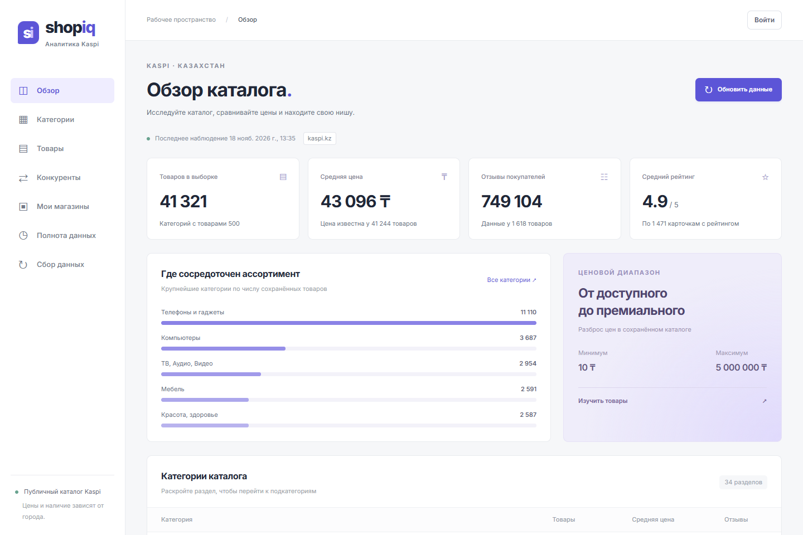
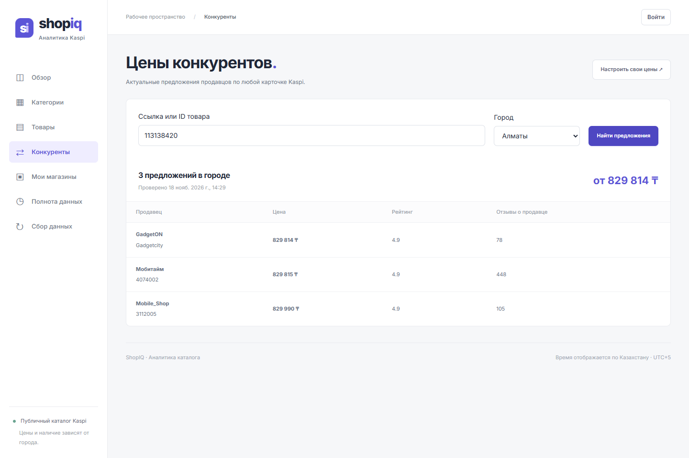
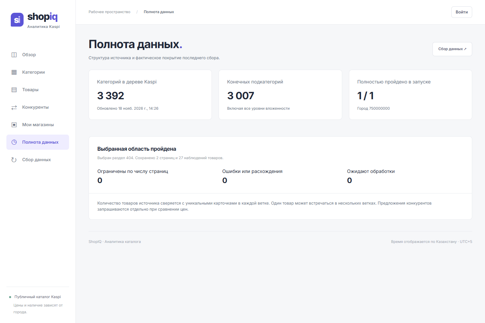

<div align="center">

# ShopIQ

**Каталог Kaspi, конкуренты и управление ценами магазина**

[](https://github.com/EclipseReign/shopiq/actions/workflows/ci.yml)
[](LICENSE)
[](package.json)

[Открыть ShopIQ](https://shopiq.feedfix-cloudflare.workers.dev) · [Архитектура](docs/architecture.md) · [Безопасность](SECURITY.md)

</div>



ShopIQ помогает исследовать ассортимент Kaspi, сравнивать предложения продавцов и управлять своим полным XML-прайсом. Для изменения цены можно выбрать подтверждение вручную или автоматическую публикацию по заданным ограничениям.

| Возможность | Как работает |
| --- | --- |
| Каталог | Вложенные категории, поиск, цены по городам, фильтры дат и сортировка |
| Конкуренты | Актуальная выдача продавцов по ссылке или ID любой карточки, с пагинацией |
| Магазины | Личный кабинет, полный XML-прайс, SKU, остатки и цены разных городов |
| Цены | Себестоимость, комиссия, налог, минимальная маржа, шаг, границы и лимит изменения |
| Автоматизация | Почасовые задания, история расчётов, ручное подтверждение и публикация в XML |
| Полнота | Сверка заявленного количества товаров с фактически сохранёнными карточками каждой ветки |

<details>
<summary>Посмотреть сравнение продавцов и отчёт о полноте</summary>





</details>

## Подключение магазина

1. Создайте аккаунт и подтвердите email.
2. В разделе «Мои магазины» укажите `merchantid` и импортируйте полный XML из своей системы учёта, до 8 МБ.
3. Создайте ссылку прайса и добавьте её в автоматическую загрузку в кабинете продавца Kaspi.
4. Для нужного SKU укажите точный ID карточки, расходы и границы цены. Выберите режим подтверждения или автоматическую публикацию.

Расчёт действует 15 минут. Подтверждение повторно проверяет версию прайса, правило и текущую цену. В XML сохраняются все исходные SKU, склады, остатки, предзаказы и остальные города. Удаление SKU при новом импорте требует отдельного подтверждения.

Kaspi загружает изменившийся прайс примерно каждый час. Статус публикации ShopIQ относится к XML-прайсу. Результат обработки проверяется в кабинете продавца. [Инструкция Kaspi](https://guide.kaspi.kz/partner/ru/shop/goods/price_list/q3251)

## Локальный запуск

Нужны Node.js 22.16+ и Python 3.10+.

```sh
npm ci
```

Скопируйте `.env.example` в `.env` и запустите приложение.

```sh
npm run dev
```

Интерфейс доступен на [localhost:3000](http://localhost:3000), Express API на `127.0.0.1:5000`. SQLite создаётся автоматически из сохранённого архива. Для локального каталога и HTTP-сборщика достаточно стандартной библиотеки Python.

```sh
# Обновить дерево категорий
npm run scrape -- --discover-only

# Собрать три страницы каждой конечной категории выбранного раздела
npm run scrape -- --category-id 16 --max-pages 3 --workers 2 --city-id 750000000

# Пройти выбранный раздел полностью
npm run scrape -- --category-id 16 --full --workers 2 --city-id 750000000
```

ID категории виден в адресе её страницы. Для локального сбора используются HTTP-запросы, транзакции после каждой страницы и сохранённые позиции. Selenium-исполнитель сохранён в `backend/scraper/scraper.py` и устанавливается отдельно через `backend/scraper/requirements.txt`.

Личный кабинет магазинов работает через облачный API. Для локальной проверки всей облачной версии задайте `SUPABASE_SERVICE_ROLE_KEY` в игнорируемом `cloud/.dev.vars`, проверьте публичные настройки `cloud/wrangler.jsonc` и выполните следующие команды.

```sh
npm run build
npm run dev --workspace cloud -- --port 3000
```

## Облачная версия

React/Vite обслуживается статическими ресурсами Cloudflare. Worker API использует Supabase Auth и PostgreSQL. Cloudflare Queues выполняет сбор и правила цен, а Durable Object переиспользует Browser Run для запросов Kaspi. [Устройство и развёртывание](docs/architecture.md)

```sh
npm test
npm run build
npm run typecheck --workspace cloud
npm audit --omit=dev
npm run deploy
```

GitHub Actions проверяет тесты, сборку, типы Worker и зависимости production на Node.js 22 и 24. Ключи сервера хранятся в Cloudflare Secrets, пароль SMTP в настройках Supabase. Для изменения SMTP через CLI используется переменная `SHOPIQ_SMTP_PASSWORD`.

## Данные

В срезе от 18 ноября 2026 года обнаружены 3 392 категории Kaspi и 3 007 конечных подкатегорий. База содержит исторические карточки из архива за апрель 2025 года и свежие наблюдения. Полнота относится к выбранной области и городу конкретного запуска. Текущее покрытие доступно в приложении. [Полнота данных](https://shopiq.feedfix-cloudflare.workers.dev/coverage)

Средняя цена и рейтинг считаются по карточкам с известными значениями. Отсутствующие данные сохраняются как `NULL`, явное отсутствие отзывов как ноль. Показатели продаж и выручки требуют данных заказов. История цен и последние наблюдения сохраняются отдельно по городам.

Исходный `kaspi.sqlite` сохранён. Локальная миграция хранит первоначальные строки в `products_before_v2`. Для новых карточек используется уникальный ID Kaspi, а связи товаров с категориями позволяют избежать двойного учёта при агрегации разделов.

Сбор всего маркетплейса содержит миллионы позиций и зависит от ресурсов исполнителя и хранилища. Сравнение продавцов запрашивает выбранную карточку непосредственно у источника. Полный ассортимент подключённого магазина берётся из XML владельца.

Лицензия MIT. [LICENSE](LICENSE)
