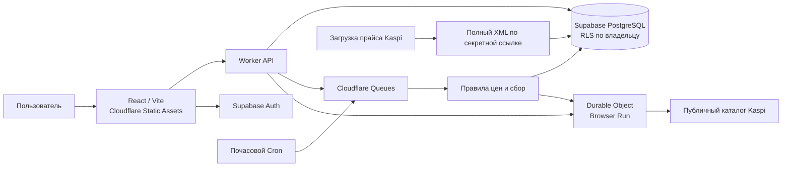

# Устройство ShopIQ



## Публичные данные

Категории имеют уникальные коды источника. Совпадающие URL разных веток сохраняют самостоятельные коды. Таблица `product_categories` хранит связи товаров с ветками, `product_city_prices` независимые наблюдения по городам, `price_history` изменения известных цен.

Публичный API предоставляет каталожные данные через ограниченные SQL-функции. Ответы общих данных кешируются на 30 секунд. Параметры поиска, дат, сортировки и страниц проверяются до запроса. Максимум списка составляет 100 товаров.

В облаке получение Kaspi использует Browser Run. Durable Object координирует собственную публичную браузерную сессию, кеширует ответы и закрывает браузер после 10 секунд простоя. Разрешены заданные пути Kaspi, загрузка изображений, шрифтов и сторонних ресурсов ограничена. В локальном исполнителе используется HTTP.

## Задания

Запуск и все задачи категорий создаются одной транзакцией. Сообщение очереди обрабатывает страницу, затем сохраняет товары, городские цены, историю, просмотренные ID и следующую позицию в одной SQL-транзакции.

Повторная доставка идемпотентна. Повтор содержимого другой страницы вызывает ошибку полноты. После последней страницы проверяется количество уникальных товаров. Изменения количества во время сбора отмечаются расхождением. Планировщик восстанавливает задержавшиеся задачи, исчерпанные повторы направляются в отдельную очередь.

## Магазины и цены

Worker проверяет пользователя через Supabase Auth. Личные запросы выполняются с его JWT, таблицы магазинов и правил ограничены RLS. Операции импорта и публикации вызываются сервером после проверки владельца.

XML хранится целиком вместе с разобранным ассортиментом. Подтверждённые цены хранятся отдельно как изменения SKU и города. Выгрузка заменяет соответствующие значения в исходном документе. Ссылка содержит случайный 256-битный токен, в базе хранится его хеш. Ротация отключает предыдущую ссылку.

Минимальная цена вычисляется с округлением вверх.

```text
расчётный минимум = ceil((себестоимость + расходы на заказ)
                        / (1 − комиссия − налог − маржа))
нижняя граница = max(заданный минимум, расчётный минимум)
```

Проценты хранятся в базисных пунктах, цены правил в целых тенге. Предложение исключает собственный магазин, учитывает свежесть наблюдения, шаг, максимальную цену и допустимое изменение. Публикация блокирует строку магазина и повторно проверяет версию прайса, правила и текущую цену. Повторное подтверждение уже опубликованного изменения возвращает тот же результат.

Общая цена XML изменяется сразу для всех городов. Сравнение такого правила выполняется в городе магазина. Для `cityprices` изменяется конкретный город.

## Развёртывание

1. Создайте проект Supabase и примените `supabase/migrations` через `supabase db push --remote=<project-ref>`.
2. Обновите account ID, URL Supabase, publishable key и email администратора в `cloud/wrangler.jsonc`. При смене проекта обновите разрешённый адрес Supabase в `frontend/public/_headers`.
3. Создайте очереди `shopiq-jobs` и `shopiq-dead-letters`.
4. Сохраните серверный ключ через `wrangler secret put SUPABASE_SERVICE_ROLE_KEY --config cloud/wrangler.jsonc`.
5. Настройте SMTP, URL сайта, разрешённые адреса возврата и подтверждение email в Supabase. Параметры описаны в `supabase/config.toml`.
6. Выполните `npm run deploy` и проверьте `/api/health`, вход, импорт XML и обработку очереди.

`scripts/sync-cloud.mjs` предназначен для первоначального переноса локального архива с сохранением числовых ID. Он требует `SUPABASE_URL` и `SUPABASE_SERVICE_ROLE_KEY` в игнорируемом `.env.cloud` и проверяет совпадение существующих идентификаторов перед импортом.

SQLite/Express остаётся локальным режимом разработки. Его `DATABASE_URL` позволяет использовать PostgreSQL, `PG_POOL_MAX` ограничивает подключения, `SCRAPER_TOKEN` защищает удалённое управление локальным исполнителем. Лимит времени задаётся `SCRAPER_TIMEOUT_MINUTES`.

Лимиты Browser Run, очереди и объём PostgreSQL определяют доступный масштаб фонового сбора. Для больших запусков следует учитывать фактическое покрытие и текущие квоты аккаунтов. [Cloudflare Browser Run](https://developers.cloudflare.com/browser-run/limits/), [Cloudflare Queues](https://developers.cloudflare.com/queues/platform/limits/)
